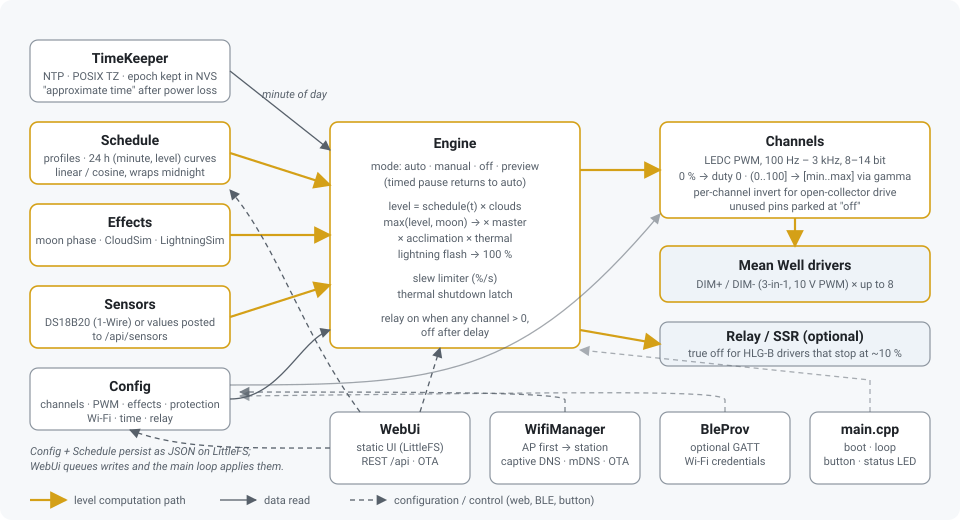

# Architecture



## Design rules

- **One source of truth per concern.** `Config` holds settings, `Schedule` holds the
  curves, `Engine` holds runtime state (mode, outputs). Nothing else caches them.
- **The main loop owns the hardware.** HTTP handlers run in the async TCP task, so
  `WebUi` only mutates in-memory structs and queues an action bitmask; `webLoop()` applies
  it from `loop()` (save to flash, reattach PWM pins, reconfigure time, connect Wi-Fi,
  reboot). This keeps LEDC, LittleFS and Wi-Fi calls on one task.
- **Outputs fail safe.** Channels are attached and set to 0 % before networking starts,
  disabled or unused channel pins are parked at their "off" level, thermal shutdown
  latches until the temperature drops below the dimming threshold.
- **Everything is JSON.** Config and profiles are serialised with ArduinoJson to
  `/config.json` and `/profiles.json` on LittleFS; the same functions back the REST API and
  the backup / restore file, so there is exactly one schema.
- **No dynamic allocation in the control path.** All structs are fixed size
  (`MAX_CHANNELS`, `MAX_PROFILES`, `MAX_POINTS` in `include/pins.h`).

## Runtime flow

`setup()` in [src/main.cpp](../src/main.cpp):

1. Mount LittleFS, load config and profiles (defaults if missing or corrupt).
2. `channelsBegin()` attaches PWM at 0 %, `engineBegin()` resets state.
3. `timeBegin()` restores the last persisted epoch from NVS (flagged approximate) and
   starts SNTP with the configured POSIX TZ.
4. `sensorsBegin()`, `wifiBegin()` (station if credentials exist, otherwise AP),
   `webBegin()`, `bleBegin()` (no-op unless built with `ENABLE_BLE`).

`loop()` polls every subsystem; the only blocking call is a 2 ms delay. `engineLoop()`
runs every 50 ms:

```
for each channel:
  level = schedule(active profile, minute of day)      # or manual / off / preview
  level *= cloud factor                                 # if channel.effects
  level  = max(level, lunarMax * moon illumination)     # if channel.moon
  level *= master/100 * acclimation * thermal
  level  = 100 if lightning flash                       # if channel.effects
  output moves toward level at most slew %/s
  channelWrite(output)  ->  min/max/gamma -> LEDC duty (inverted if configured)
relay = any output > 0 (off after delay)
```

`timeKnown()` gates the schedule: with no NTP and no restored epoch the engine holds
`fallbackLevel` instead of running a curve at a wrong time.

## Components

| Component | Files | Responsibility |
|---|---|---|
| Config | `src/Config.*` | `Config` struct, defaults, JSON in/out, `/config.json`. Passwords are masked in the API unless `includeSecrets`. |
| Schedule | `src/Schedule.*` | `Profiles` (up to 5), per-channel sorted `(minute, level)` points, `scheduleLevelAt()` with linear or cosine interpolation and midnight wrap. |
| Effects | `src/Effects.*` | Moon phase from a known new-moon epoch; `CloudSim` random smooth dips; `LightningSim` random pulse groups. Pure functions / small state machines, no hardware. |
| Engine | `src/Engine.*` | Mode state machine (auto, manual, off, preview, timed return to auto), combines all inputs, slew limiter, thermal latch, relay, status JSON. |
| Channels | `src/Channels.*` | LEDC attach/detach, logical % → driver % mapping, inversion, parking of unused pins. |
| TimeKeeper | `src/TimeKeeper.*` | SNTP with TZ, epoch persisted to NVS every 5 min, manual set from browser, synced / approximate / unknown flags. |
| Sensors | `src/Sensors.*` | Non-blocking DS18B20 polling; externally posted temperature and humidity with a 10 min staleness window. |
| WifiManager | `src/WifiManager.*` | Station with 20 s timeout → AP `LEDctrl-xxxx` with captive DNS; retries station every 2 min; closes AP 3 min after station is up; mDNS and ArduinoOTA once connected. |
| WebUi | `src/WebUi.*` | ESPAsyncWebServer: static files from `/www`, JSON API, captive-portal probes, OTA upload, deferred action queue. |
| BleProv | `src/BleProv.*` | NimBLE service 0xFFF0: write SSID / password / connect, notify Wi-Fi status. Compiled only in `esp32dev-ble`. |
| Web UI | `data/www/` | Single-page vanilla JS app polling `/api/status` every 2 s; schedule editor draws curves with the same interpolation as the firmware (tested in `test/ui`). |

## Memory and flash

Partition table `min_spiffs.csv`: two 1.9 MB OTA app slots and a ~190 KB LittleFS. The
UI is ~40 KB uncompressed. Static RAM use is about 60 KB on esp32dev; profiles are the
largest static block (~5.4 KB).

## Extending

- A new effect: add a simulator to `Effects.*`, a factor in `engineLoop()`, flags in
  `Config` (+ JSON in/out) and inputs in the Effects tab.
- A new sensor: feed `sensorsSetExternal()` or extend `Sensors.cpp`; the engine only
  calls `sensorTemperature()`.
- A new board: add a block to `include/pins.h` and an `[env:...]` to `platformio.ini`.
